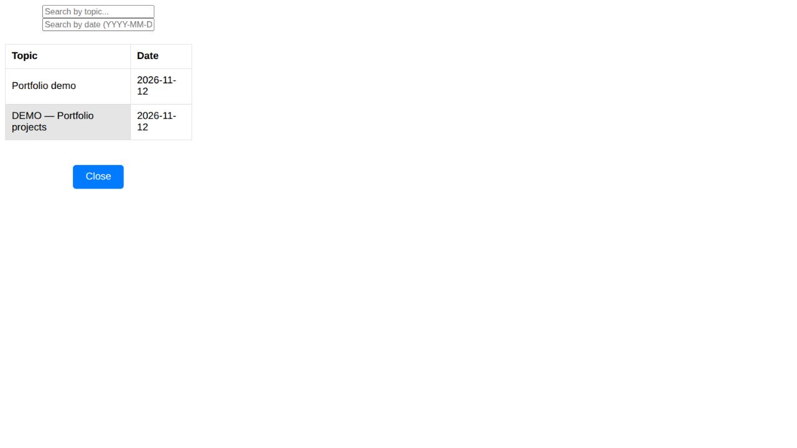
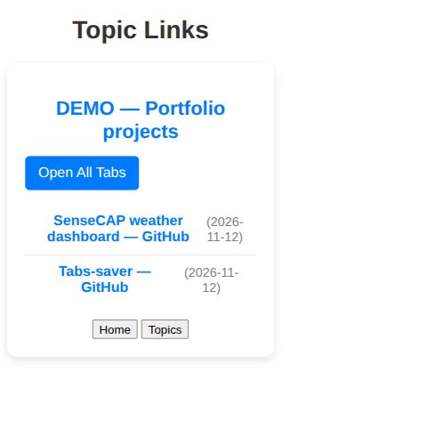

# Tabs-Saver

A browser extension project for organising browsing links by research topic, built with vanilla JavaScript, a Flask JSON API and SQLite.

## What the project demonstrates

The extension interface loads HTML screen fragments and calls the Flask API to save links, list saved topics and retrieve links for a topic. SQLite stores the topic, date, title and URL. The code also includes browser tab capture (`chrome.tabs.query`) and reopening (`chrome.windows.create`); those browser integrations were **not tested** in the local review.

For a Junior Software Developer portfolio, this project demonstrates JavaScript DOM updates, asynchronous API calls, Python request handling and SQL persistence. The frontend is plain HTML/CSS/JavaScript; Flask serves JSON rather than rendering the interface.

## Local demonstration — synthetic data

Captured on **12 November 2026** for a portfolio review supporting a Saolix Junior Software Developer application. Both screenshots show a **local web preview of the extension interface using synthetic data**, not an installed-extension end-to-end test or a hosted deployment.

The temporary preview used a writable local database path in place of the hard-coded Windows path in `server/app.py`, and served the existing frontend files locally. That adjustment is not included in this documentation change. Sample links point to public project repositories; no real browsing history was used.

### Saved topics — local demonstration using synthetic data

The existing interface lists sample topics returned by Flask/SQLite.



### Retrieved links — local demonstration using synthetic data

Selecting a sample topic retrieves its saved GitHub links. The visible “Open All Tabs” button does not establish that reopening worked: **browser tab capture and reopening were not tested**.



See [screenshot context and limitations](docs/screenshots/README.md).

## Implemented behavior and verification limits

- Flask endpoints: `POST /save_links`, `GET /get_topics`, and `GET /get_links/<topic>`.
- With the temporary database-path adjustment, API checks passed for saving a sample link, listing topics, retrieving the link and rejecting an empty link list.
- The local browser preview displayed topics and retrieved links. Extension installation, permissions, tab capture and reopening remain unverified.
- Save handling does not check `response.ok` before reporting success; a JSON error response can appear successful. Robust error handling remains follow-up work.

## Local setup status

```bash
git clone https://github.com/Paulshapwala/Tabs-saver.git
cd Tabs-saver
```

The current checkout is not a portable, ready-to-run demo. Before running it:

1. Create an isolated Python environment and install Flask. A backend dependency manifest is still needed; avoid relying on the committed Windows environment under `server/TABS`.
2. Configure a writable database path in `server/app.py`. Its current hard-coded Windows path fails on Linux. A portable configuration mechanism is planned.
3. Start the backend with `python server/app.py`; the frontend expects `http://localhost:5000`.
4. For extension testing in a Chrome-based browser, open `chrome://extensions/`, enable Developer Mode and use **Load unpacked** to select `extension/`. Validate browser/API integration before relying on save or reopen actions.

The screenshots document a separate temporary preview; these instructions do not claim that a fresh-clone extension workflow has been verified.

## Planned improvements

These are proposals, not current capabilities:

- Portable database configuration, dependency manifest and improved API error handling.
- End-to-end extension testing of save → list → retrieve → reopen.
- PostgreSQL migration, a possible FastAPI backend migration, AI-assisted categorisation, authentication and multi-user storage.
- Future cloud hosting, previously proposed for PythonAnywhere and Google Cloud. No currently live deployment is demonstrated here.

## License

This project is licensed under the Apache License 2.0. See [LICENSE](LICENSE).

## Contribution

Contributions are welcome through issues and pull requests.
